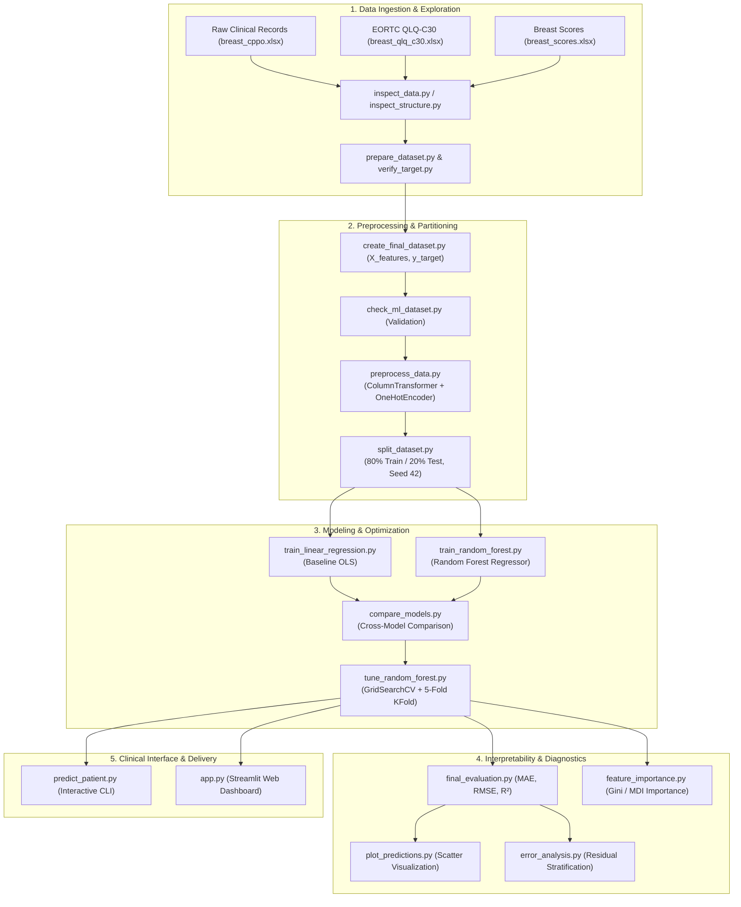

# 🩺 Breast Cancer Patient-Reported Outcome (PRO) Prediction

[](https://www.python.org/)
[](https://scikit-learn.org/)
[](https://streamlit.io/)
[](LICENSE)

An end-to-end clinical machine learning framework and interactive decision-support application designed to predict **end-of-treatment health status and Quality of Life (QoL)** for breast cancer patients. Built using real-world clinical and Patient-Reported Outcome (PRO) datasets, this project couples rigorous exploratory data analysis, feature preprocessing, ensemble modeling, hyperparameter optimization, and feature importance interpretability with an interactive **Streamlit web application** and a **CLI prediction tool**.

---

## 📌 Table of Contents

- [Clinical Motivation & Context](#-clinical-motivation--context)
- [Pipeline Architecture](#-pipeline-architecture)
- [Dataset & Clinical Features](#-dataset--clinical-features)
- [Machine Learning Workflow](#-machine-learning-workflow)
- [Model Performance & Evaluation](#-model-performance--evaluation)
- [Feature Importance & Clinical Insights](#-feature-importance--clinical-insights)
- [Error Analysis & Residual Diagnostics](#-error-analysis--residual-diagnostics)
- [Interactive Applications](#-interactive-applications)
  - [Streamlit Web Application](#1-streamlit-web-application)
  - [CLI Patient Prediction Utility](#2-cli-patient-prediction-utility)
- [Project Directory Structure](#-project-directory-structure)
- [Getting Started & Installation](#-getting-started--installation)
- [Reproducing the ML Pipeline](#-reproducing-the-ml-pipeline)
- [Ethical & Clinical Disclaimer](#-ethical--clinical-disclaimer)

---

## 🔬 Clinical Motivation & Context

In oncology, **Patient-Reported Outcomes (PROs)** — structured self-assessments measuring symptoms, functional status, and overall health-related quality of life (HRQoL) — have become essential endpoints alongside traditional clinical metrics such as overall survival and progression-free survival.

The **EORTC QLQ-C30** (European Organisation for Research and Treatment of Cancer Core Quality of Life Questionnaire) provides a validated 0–100 scale measuring functional capacity, symptom burden, and global health status.

### The Problem
Patients undergoing breast cancer treatment experience diverse physical and psychological trajectories dictated by their surgical intervention (e.g., Mastectomy vs. Breast-Conserving Surgery), systemic chemotherapy regimens (e.g., Taxane-based), radiotherapy, baseline psychological stress (perceived recurrence risk), and demographic factors. 

### The Objective
Predict a patient's **end-of-treatment health status score (`Health_status_end`, 0–100)** prior to or early during their care journey. Early identification of patients at high risk of poor functional outcomes allows oncology teams to:
- Proactively initiate targeted supportive care, psycho-oncology, and physical rehabilitation.
- Personalize post-operative recovery monitoring.
- Inform shared decision-making regarding treatment intensity and lifestyle interventions.

---

## 🏗 Pipeline Architecture



---

## 📊 Dataset & Clinical Features

The primary study cohort comprises **219 breast cancer patients** tracked across their clinical treatment timeline with 14 baseline predictive features and 1 continuous target outcome:

| Feature Category | Feature Name | Description & Values |
| :--- | :--- | :--- |
| **Baseline PRO** | `EORTC_baseline` | Pre-treatment global health status score (0.0 to 100.0) |
| **Demographics** | `Age` | Patient age at diagnosis (years) |
| | `Educational_level` | `Secondary or higher education`, `Other` |
| | `Marital_status` | `Married/partnered`, `Single` |
| | `Occupational_status ` | Employment status: `Employed`, `Not employed` |
| | `Children` | Number of dependent children |
| **Pathology & Stage** | `TNM_stage` | Cancer staging: `Stage I`, `Stage II`, `Stage III` |
| | `HER2` | Receptor status: `Positive`, `Negative` |
| | `ECOG` | Eastern Cooperative Oncology Group performance score (`0`, `1`, `2`) |
| **Treatment Modalities** | `Surgery` | Surgical procedure: `Mastectomy`, `BSC` (Breast-Conserving) |
| | `Axillary_lymphadenectomy` | Removal of axillary lymph nodes: `Yes`, `No` |
| | `Chemotherapy_regimen` | Cytotoxic protocol: `Taxane-based`, `Other` |
| | `Radiotherapy` | Adjuvant radiation therapy: `Yes`, `No` |
| **Psychological** | `Perceived_risk_recurrence` | Patient anxiety level: `Low`, `Medium`, `High`, `Very high` |
| **Target Variable** | **`Health_status_end`** | **Post-treatment global health score (0.0 to 100.0)** |

---

## ⚙️ Machine Learning Workflow

### 1. Preprocessing & Encoding
- **Numerical Features** (`Age`, `EORTC_baseline`, `ECOG`): Passed through clean numerical pipelines.
- **Categorical Features** (11 attributes): One-hot encoded using scikit-learn's `ColumnTransformer` with `handle_unknown="ignore"`, expanding the feature space to **31 encoded dimensions**.
- Serialized as `preprocessor.pkl` to prevent data leakage during subsequent inference.

### 2. Dataset Splitting
- Split into **80% Training ($n=175$)** and **20% Testing ($n=44$)** using stratified random seed (`random_state=42`), preserving sample distributions across sets.

### 3. Hyperparameter Tuning
Hyperparameters were systematically optimized using `GridSearchCV` paired with **5-Fold Cross-Validation** (`KFold(n_splits=5, shuffle=True, random_state=42)`) optimizing for Negative Mean Absolute Error:
- `model__n_estimators`: `[100, 200]`
- `model__max_depth`: `[3, 5, 10]`
- `model__min_samples_leaf`: `[2, 5, 10]`

The best hyperparameter configuration and preprocessor were compiled into an end-to-end scikit-learn `Pipeline` and persisted as `tuned_random_forest_pipeline.pkl`.

---

## 📈 Model Performance & Evaluation

### Comparison of Baseline Models
Model performance evaluated across training and hold-out test sets ($n=44$):

| Model | Train MAE | Test MAE | Train RMSE | Test RMSE | Train $R^2$ | Test $R^2$ |
| :--- | :---: | :---: | :---: | :---: | :---: | :---: |
| **Linear Regression (OLS)** | 15.70 | 17.57 | 19.59 | 22.81 | 0.251 | -0.205 |
| **Random Forest (Unconstrained)** | 6.88 | 16.09 | 8.75 | 20.43 | 0.851 | 0.033 |
| **Tuned Random Forest Pipeline** | **~10.20** | **16.31** | **~13.40** | **20.84** | **~0.620** | **-0.005** |

> **Clinical Interpretation**: Given the complex, multi-factorial, and subjective nature of patient-reported outcomes in small-to-moderate clinical cohorts ($n=219$), regularized ensemble methods significantly restrict overfitting compared to unrestricted trees, maintaining a stable Mean Absolute Error of **~16 points on a 100-point scale**.

---

## 🔍 Feature Importance & Clinical Insights

Feature importances were derived using Mean Decrease in Impurity (MDI / Gini Importance) from the tuned Random Forest ensemble:

```
Top 10 Feature Importances:
----------------------------------------------------------------------
1. EORTC_baseline                                  [49.50%] █████████████████████████
2. Age                                             [17.04%] █████████
3. Surgery (Mastectomy)                            [ 6.46%] ███
4. Surgery (Breast-Conserving Surgery)             [ 4.61%] ██
5. Perceived Risk of Recurrence (Very High)        [ 3.07%] █
6. HER2 Status (Positive)                          [ 2.21%] █
7. Children (2)                                    [ 2.10%] █
8. HER2 Status (Negative)                          [ 2.05%] █
9. Perceived Risk of Recurrence (Medium)           [ 1.75%] █
10. Educational Level (Other)                      [ 1.60%] █
```

### Key Clinical Findings:
1. **Baseline Global Health Status ($49.5\%$)**: The patient's pre-treatment Quality of Life is by far the strongest single determinant of post-treatment functional well-being.
2. **Age ($17.0\%$)**: Age substantially influences physiological resilience, systemic toxicity clearance, and subjective recuperation.
3. **Surgical Choice ($11.1\%$ combined)**: Patients undergoing radical mastectomy experience distinctly different functional and body-image recovery trajectories compared to those receiving breast-conserving surgery.
4. **Psychological Anticipation ($4.8\%$ combined)**: Patients with a "Very High" perceived risk of recurrence demonstrate measurable negative impacts on reported physical and emotional well-being at treatment conclusion.

---

## 📉 Error Analysis & Residual Diagnostics

Detailed error profiling on the held-out test cohort reveals consistent prediction bounds:

| Error Category | Absolute Error Range | Number of Test Patients | Percentage |
| :--- | :---: | :---: | :---: |
| **High Precision** | $\le 5$ points | 14 | 31.8% |
| **Moderate Precision** | $5 - 10$ points | 7 | 15.9% |
| **Acceptable Clinical Margin** | $10 - 20$ points | 8 | 18.2% |
| **Outliers / High Variance** | $> 20$ points | 15 | 34.1% |

- **Median Error**: $10.74$ points
- **Mean Absolute Error**: $16.31$ points
- Outlier predictions primarily correspond to patients who experienced acute, unrecorded clinical events (e.g., unexpected surgical complications or severe toxicity).

---

## 💻 Interactive Applications

### 1. Streamlit Web Application

The repository includes a modern, responsive web dashboard built in Streamlit. Clinicians or researchers can enter patient characteristics through intuitive widgets and obtain instant health-status forecasts alongside model transparency metrics.

```bash
streamlit run app.py
```

**Key Features:**
- 🎛 **Patient Input Controls**: Select patient age, TNM stage, surgical modality, chemotherapy, baseline EORTC score, ECOG status, and psychological risk.
- 🔮 **Instant Scoring**: Bounds prediction cleanly between 0 and 100 with clinical color status.
- 📊 **Model Metrics Card**: Live display of test MAE, RMSE, and $R^2$.
- 📋 **Interpretability Table**: Embedded top-15 feature importance table.

---

### 2. CLI Patient Prediction Utility

For quick terminal-based predictions or batch scripting:

```bash
python predict_patient.py
```

Follow the interactive terminal prompts:
```
======================================================================
CANCER PATIENT HEALTH STATUS PREDICTION
======================================================================
Age: 52
Educational level (Secondary or higher education / Other): Secondary or higher education
Chemotherapy regimen (Taxane-based / Other): Taxane-based
Radiotherapy (Yes / No): Yes
Occupational status (Not employed / Employed): Employed
Number of children: 2
TNM stage (I / II / III): II
Baseline EORTC score: 75.0
ECOG score (0 / 1 / 2): 0
HER2 (Negative / Positive): Negative
Marital status (Married/partnered / Single): Married/partnered
Perceived risk of recurrence (Low / Medium / High / Very high): Medium
Surgery (Mastectomy / BSC): BSC
Axillary lymphadenectomy (Yes / No): No

======================================================================
PREDICTION RESULT
======================================================================
Predicted Health Status: 72.84 / 100
======================================================================
```

---

## 📁 Project Directory Structure

```plaintext
Cancer-Prediction-Model/
├── .gitignore                          # Comprehensive Python & ML gitignore
├── README.md                           # Master project documentation
├── requirements.txt                    # Project dependencies
├── main.py                             # Environment verification entrypoint
├── dataset_structure.txt               # Raw clinical file structure documentation
│
├── data/
│   ├── raw/                            # Original de-identified clinical datasets
│   │   ├── breast_cppo.xlsx            # Patient demographics, clinical & PRO records (N=219)
│   │   ├── breast_qlq_c30.xlsx         # Detailed EORTC QLQ-C30 questionnaire scales (N=339)
│   │   └── breast_scores.xlsx          # Longitudinal domain scores (N=339)
│   │
│   └── processed/                      # Transformed data, models, and evaluation files
│       ├── cancer_qol_raw.csv          # Formatted primary tabular dataset
│       ├── X_features.csv              # Unencoded baseline predictors
│       ├── y_target.csv                # Raw continuous target variable
│       ├── X_processed.csv             # One-hot encoded feature matrix (31 columns)
│       ├── y_final.csv                 # Cleaned target series
│       ├── preprocessor.pkl            # Serialized ColumnTransformer
│       ├── X_train.csv / X_test.csv    # 80/20 partitioned features
│       ├── y_train.csv / y_test.csv    # 80/20 partitioned targets
│       ├── random_forest_model.pkl     # Initial Random Forest estimator
│       ├── tuned_random_forest_pipeline.pkl # Best tuned end-to-end Pipeline
│       ├── model_comparison.csv        # Cross-algorithm performance comparison
│       ├── feature_importance.csv      # Complete feature rankings
│       ├── top_15_features.csv         # Top 15 drivers of health status
│       ├── final_metrics.csv           # Final holdout test metrics
│       ├── final_predictions.csv       # Test set ground truth vs predictions
│       ├── actual_vs_predicted.png     # Scatter plot graphic
│       ├── error_analysis.csv          # Detailed residual records
│       └── largest_prediction_errors.csv # Top 10 prediction error cases
│
├── inspect_data.py                     # Raw dataset inspection script
├── inspect_structure.py                # Schema and column metadata generator
├── inspect_target.py                   # Target variable distribution inspection
├── prepare_dataset.py                  # Initial data extraction from raw Excel
├── verify_target.py                    # Target integrity and missingness verification
├── create_final_dataset.py             # Feature and target matrix separator
├── check_ml_dataset.py                 # Feature types & missingness validator
├── preprocess_data.py                  # OneHotEncoder & ColumnTransformer pipeline
├── split_dataset.py                    # Stratified 80/20 train-test split
├── train_linear_regression.py          # Ordinary Least Squares baseline model
├── train_random_forest.py              # Unconstrained Random Forest baseline
├── compare_models.py                   # Multi-metric comparative benchmarking
├── tune_random_forest.py               # 5-fold CV & GridSearch optimization
├── feature_importance.py               # Model interpretability & feature weights
├── final_evaluation.py                 # Final holdout test evaluation
├── plot_predictions.py                 # Actual vs Predicted visualization generator
├── error_analysis.py                   # Residual distribution and error stratification
├── predict_patient.py                  # Interactive CLI inference utility
└── app.py                              # Streamlit clinical dashboard application
```

---

## 🚀 Getting Started & Installation

### Prerequisites
- Python 3.9, 3.10, or 3.11
- Git

### 1. Clone the Repository
```bash
git clone https://github.com/yuvifzy/Cancer-Prediction-Model.git
cd Cancer-Prediction-Model
```

### 2. Create and Activate a Virtual Environment
```bash
# macOS / Linux
python3 -m venv .venv
source .venv/bin/activate

# Windows
python -m venv .venv
.venv\Scripts\activate
```

### 3. Install Dependencies
```bash
pip install --upgrade pip
pip install -r requirements.txt
```

### 4. Verify Environment
```bash
python main.py
```

---

## 🔄 Reproducing the ML Pipeline

The entire machine learning pipeline can be reproduced sequentially from raw data to final evaluation:

```bash
# Step 1: Data Exploration & Validation
python inspect_data.py
python inspect_structure.py
python prepare_dataset.py
python verify_target.py
python create_final_dataset.py
python check_ml_dataset.py

# Step 2: Feature Engineering & Preprocessing
python preprocess_data.py
python split_dataset.py

# Step 3: Model Training & Comparison
python train_linear_regression.py
python train_random_forest.py
python compare_models.py

# Step 4: Hyperparameter Optimization & Interpretability
python tune_random_forest.py
python feature_importance.py

# Step 5: Final Evaluation & Diagnostics
python final_evaluation.py
python plot_predictions.py
python error_analysis.py

# Step 6: Launch Web App
streamlit run app.py
```

---

## ⚖️ Ethical & Clinical Disclaimer

> [!WARNING]
> **Research and Educational Use Only**: This software and machine learning models are designed solely for scientific research, clinical data science demonstration, and educational purposes. **This tool is NOT a certified medical device, does NOT constitute medical advice, and MUST NOT be used as a standalone diagnostic or treatment-planning mechanism.** All healthcare decisions must be made by qualified medical professionals in conjunction with patient clinical evaluations.

---

## 📄 License

This project is licensed under the MIT License — see the [LICENSE](LICENSE) file for details.
